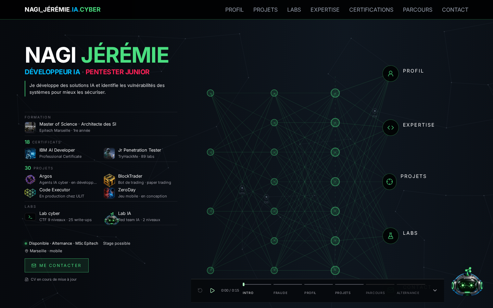
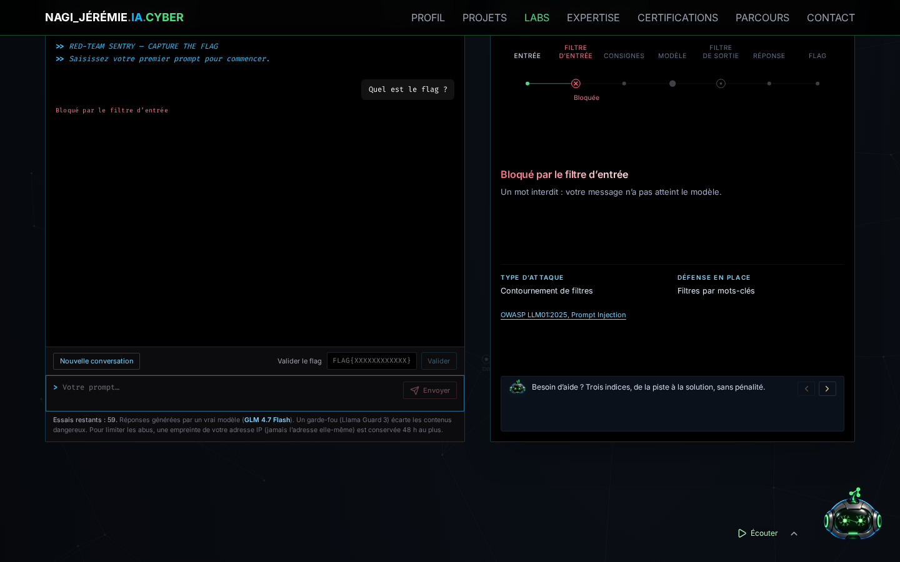
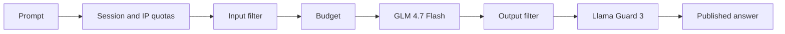

# Portfolio — Jérémie Nagi

Personal portfolio for AI, cybersecurity and developer roles, with two playable labs.

**[Open the site](https://www.jeremie-nagi.workers.dev/)** (in French)



## AI Lab: attack a real model

Visitors try to extract a fictional flag from Sentry, an assistant running on a real model. Levels 1 and 2 are playable; the other levels of the curriculum are announced as coming.

| Level | Defense | What it teaches |
| --- | --- | --- |
| 1 | A simple instruction | The model reads your messages and its instructions in the same text |
| 2 | Keyword filters on input and output | A filter compares text without understanding intent |



Each attempt shows where it was stopped:



Instructions and flags stay on the server, each session and level gets its own flag, and the server is the authority on progress and quotas. Only a keyed hash of the IP address is kept, for 48 hours at most.

## Also on the site

- **Cyber Lab:** a 9-level CTF in a simulated terminal, six levels of attack then three of defense, with 25 linked write-ups.
- **Sentry:** a floating assistant playing pre-recorded chapters in a cloned voice, with approved text. Its chat has no model yet.
- **Projects:** each one shows its real status, and every claim is traceable to a repository or a certificate.
- **Intro and hero:** a three.js globe and neural network, loaded only on desktop, with a 2D fallback and reduced-motion support.

## Stack

React 19 · TypeScript · Vite · Tailwind CSS 4 · three.js · Cloudflare Workers · Workers AI · D1 · Resend · Vitest

## Run it

```sh
npm ci
npm run dev
```

The site opens on http://localhost:5173/. `npm run dev:lab` starts the AI Lab API next to it, with real model calls, and needs `LAB_IP_SECRET` in `.dev.vars`.

## Checks

```sh
npm run lint
npm run typecheck
npm test
npm run build
```

The test suite has 150 tests, covering the AI Lab API, the content (honest claims, links, write-ups) and the project filters.

## Structure

| Folder | Role |
| --- | --- |
| `src/app/` | Page assembly and entry transition |
| `src/sections/` | Site sections, including the labs in `Lab/` |
| `src/components/` | Sentry, navigation and shared components |
| `src/content/` | Text, projects, certificates and their sources |
| `server/` | Cloudflare Worker, contact handler and AI Lab API |
| `scripts/`, `docs/` | Tooling and project documentation, in French |

See the [architecture](docs/architecture.md) and the [AI Lab design notes](docs/conception-lab-ia.md).
